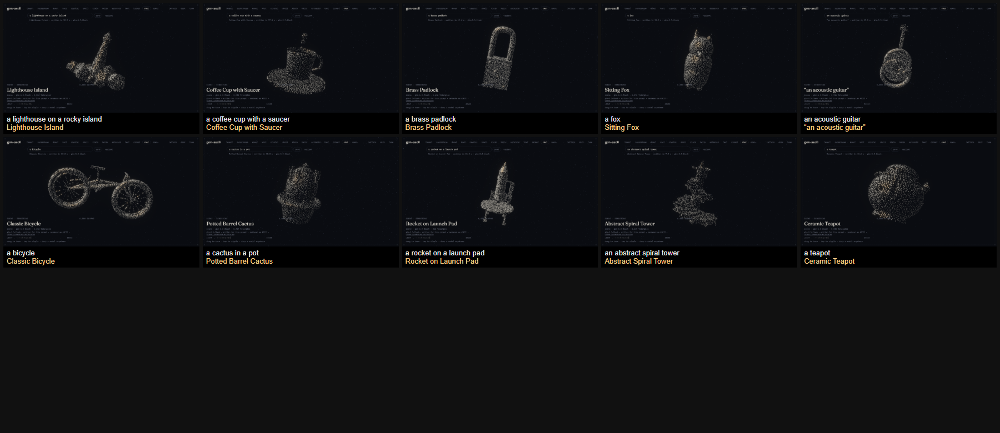

# The chat backend: what was measured

Issue #29 asked for a local model that writes Three.js scenes for ten prompts, each rendered and
judged by eye, with the pass rate and the cost per scene recorded. The architecture (option C: a
model writes 3D code, the engine renders it) stands. The local-model part does not: the model runs on
a hosted gateway behind this app's own endpoint, so there are no weights to download and no VRAM
figure to report. Everything else below is a measurement, and the ten prompts are the issue's.

## What was run

| step | command | what it answers |
|---|---|---|
| mechanical spike | `node --env-file=.env scripts/scene-spike.ts --model glm-5.3-flash --out .cache/spike/spike.json` | does the model return code this app can run, how many triangles, how long |
| in-app, by eye | `node .hermes/verify/chat-driver.mjs --density 6000` against `npm run dev` | does the rendered scene read as the prompt, and how long to the first frame |

The driver starts its own headless Chrome, opens each prompt as a `?chat=` link, waits on the
stage's own `rendering` phase, holds three seconds so the StrictMode double-assemble has settled,
and screenshots. The screenshots were then judged with a vision model, one at a time at full size.

## The model

Measured on one prompt each, sequentially (`glm-5.3-flash` won on both counts):

| model | latency | result |
|---|---|---|
| `glm-5.3-flash` | 12.9 s | scene ran, 35 parts, 1,880 triangles |
| `deepseek-v4.1-flash` | 24.9 s | scene ran, 35 parts, 1,428 triangles |
| `glm-5.3` | — | reply cut short at the token cap before the fixes below |
| `kimi-k2.7-code` | 22.1 s | reply cut short: its reasoning trace spends the completion budget |
| `qwen3.8-flash` | >150 s | no answer inside the timeout |
| `grok-4.6` | — | the gateway answered 400 |

`glm-5.3-flash` is the default. `SCENE_MODEL` overrides it.

## The spike, ten prompts

Run before and after the fixes below, same ten prompts, same seed per prompt:

| run | scenes that ran | median | slowest | triangles |
|---|---|---|---|---|
| first | 6/10 | 11.9 s | 16.3 s | 1,232–3,840 |
| after the fixes | 10/10 | 11.6 s | 17.2 s | 1,148–5,468 |

The four failures in the first run were not the model failing to write a scene. Three replies were
well-formed code with the labels out of order (one opened straight into `CODE:` with no title, one
put its `TITLE:` after the body), and one used `window.innerWidth` to size itself. The parser now
finds the title anywhere and the code after its label, a missing title is named after the prompt, and
a refusal buys one corrective turn before the backend gives up.

## In the app

Ten prompts, 6,000 glyphs (the default), 1280×800, headless Chrome on this machine (Windows 11,
RTX 3090 24 GB; the stage is not the bottleneck here, the model is):

- **10 of 10 drawn.** Each one read as its prompt at full size: lighthouse, coffee cup and saucer,
  padlock, fox, guitar, bicycle, cactus in a pot, rocket on a launch pad, spiral tower, teapot.
- **Time to first glyph frame.** A fresh scene: 9.8–22.8 s from navigation, of which the model
  reported 7.2–20.3 s of writing. A repeat prompt is a cache hit and settles in 3.3 s from
  navigation; the fastest cached scene settled at 2.6 s, so most of that is the page load itself
  rather than the scene.

- **One writer failure in about thirty requests.** "a rocket on a launch pad" came back 502 twice in
  a row on one attempt and succeeded on the next. The composer says so, and sending again or pressing
  *variant* recovers it. The scene is not cached when it fails, so a retry is one call.

**The budget, set and met:** a fresh scene reaches its first glyph frame inside 25 s, and a repeat
prompt inside 4 s. Both bounds are above the slowest measurement on this machine.

## What is still open

- **The ten prompts are ten prompts.** A cliff in quality for a category the set does not cover
  (a face, an animal in motion, a scene with two subjects) would not have shown up here.
- **A thumbnail read is harsher than the canvas.** Contact-sheeted at a fifth of their size, one tile
  out of ten stops reading as its prompt. That is a size of the picture, not of the scene, but it is
  the honest note about how much the read depends on looking at the app's own canvas.
- **The credits are ours, not a licence.** A written scene is model output, so the caption names the
  writer and where it runs. There is no author to credit and no licence to honour, unlike a Commons
  model or an Objaverse row.
